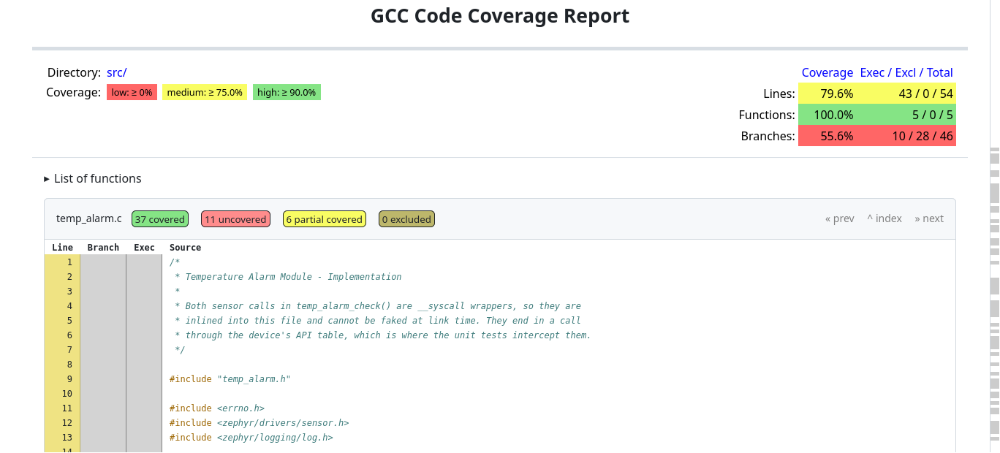
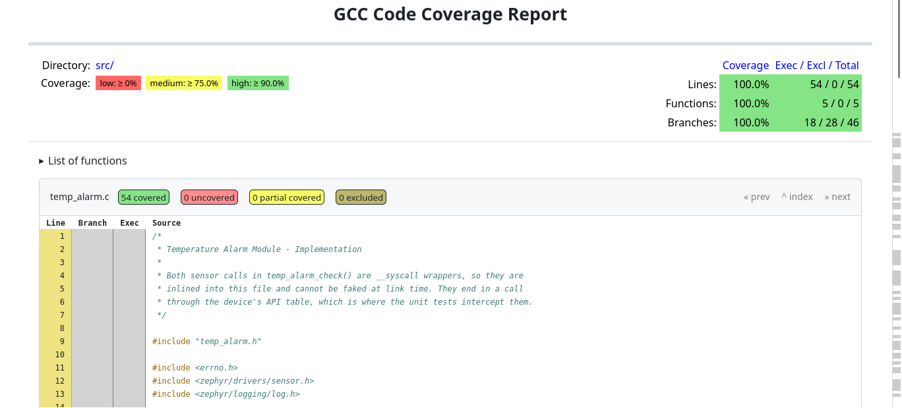

# Task 3 — Coverage Analysis

The code coverage report was generated for both tags l8-task1 and l8-task2, using the command provided. The files generated for both cases were saved and can be found in this directory:

- `l8_task3/coverage_task_1/index.html`
- `l8_task3/coverage_task_2/index.html`

Here is a screen capture of both cases, the results are the expected ones:

Code coverage report for l8-task1:

Code coverage report for l8-task2:

## Which lines did Task 2 reach that Task 1 could not?
Even though task 1 and task 2 reached the same functions, task 2 added tests for cases where not expected values were passed to the functions. The functions evaluated were still 100%, but task 2 added the branches and the lines of the `temp_alarm` module.
